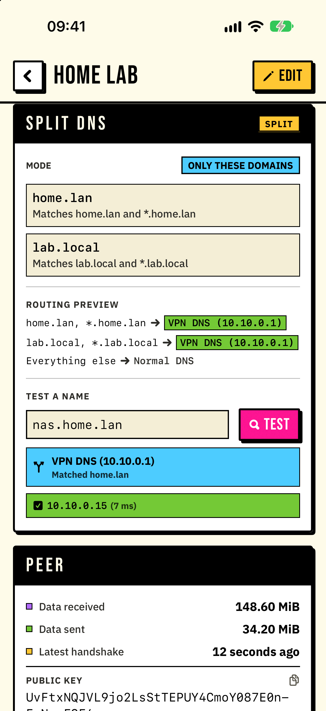
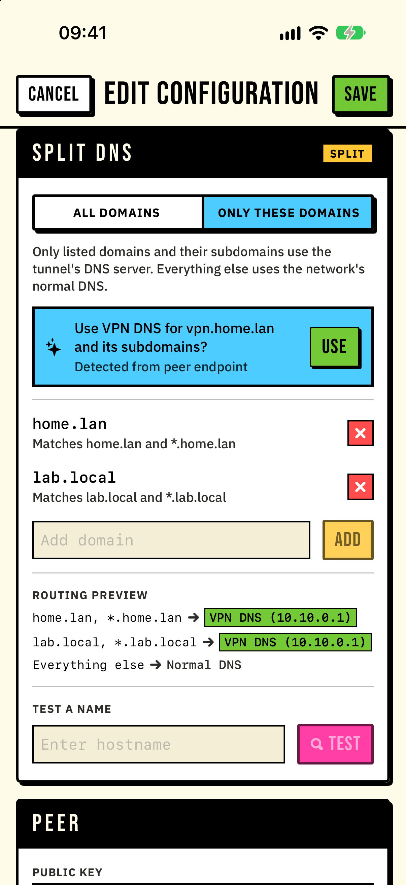
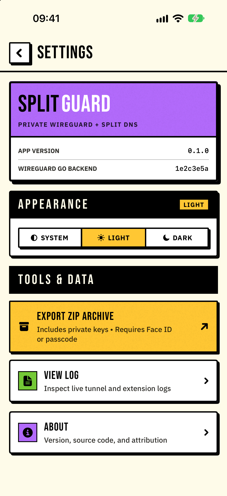

# SplitGuard

SplitGuard is an iPhone client for WireGuard VPN tunnels with per-tunnel split DNS. It runs on iOS 26 and later.

  
  
  
  

## Split DNS

The official WireGuard iOS app sends every DNS lookup to the tunnel's DNS server while a tunnel is active. If you only connect to a home network or office VPN to reach internal services, all your regular browsing lookups still go through that server.

SplitGuard lets you choose how DNS works per tunnel. You can send all domains to the tunnel's DNS server like the official app does, or pick a list of domains instead. Each domain you add covers itself and its subdomains, and everything else uses the normal DNS of your current Wi-Fi or cellular network.

When you import a tunnel whose endpoint uses a hostname, SplitGuard suggests enabling split DNS for that domain. A routing preview shows which domains use the VPN DNS server and which stay on normal DNS. You can also type a hostname into the built-in tester to see which DNS path it takes and what address it resolves to while connected.

Split DNS rules are saved alongside the standard WireGuard configuration. When you export tunnels, those rules are written as `# SplitGuard:` comments in the `.conf` file, so other WireGuard apps ignore them and can still import the file.

## What else it does

- Import tunnels by scanning a QR code, opening a `.conf` file or `.zip` archive, pasting a configuration from the clipboard, or creating one from scratch with a generated keypair.
- Keep multiple tunnels configured with one active at a time. You can pin a primary tunnel to the top of the screen to see its connection state, data sent and received, and latest handshake time.
- Edit WireGuard tunnel and peer settings.
- Connect automatically with on-demand rules for Wi-Fi and cellular, with optional rules to include or exclude specific Wi-Fi networks.
- Toggle recent tunnels from the iPhone Home Screen quick actions menu.
- Export all tunnels as a `.zip` archive behind Face ID or your device passcode. Viewing private keys requires authentication as well.
- View and export tunnel logs.
- Switch between light, dark, and system appearance.

## Privacy

SplitGuard has no accounts, no analytics, no tracking, and no backend server. It only connects to the WireGuard servers you configure. Tunnel configurations stay on your iPhone, with private keys stored in the iOS Keychain. See [PRIVACY.md](PRIVACY.md) for the full privacy policy.

## Attribution

SplitGuard uses the WireGuard tunnel, cryptography, and configuration code from [wireguard-apple](https://git.zx2c4.com/wireguard-apple) and wireguard-go under the MIT License.

"WireGuard" is a registered trademark of Jason A. Donenfeld. SplitGuard is not affiliated with or endorsed by the WireGuard project.
