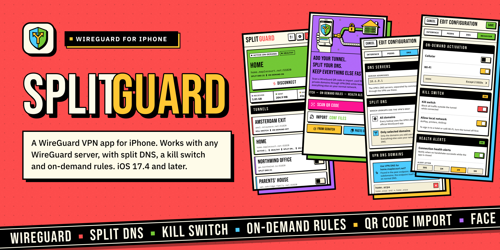

# SplitGuard

SplitGuard is a WireGuard VPN app for iPhone. It works with any WireGuard server and imports the same configuration files and QR codes as other WireGuard apps. On top of that it lets you decide which websites use the VPN's DNS, block traffic when the VPN drops, get notified when a server stops responding, and control your tunnels from Shortcuts. It runs on iOS 17.4 and later.

## Split DNS

- Send only the domains you choose, such as `home.lan` or `corp.example.com`, to the VPN's DNS server. Everything else uses your normal Wi-Fi or cellular DNS.
- Or send every lookup through the VPN, per tunnel.
- Add exceptions for names that should stay on normal DNS, like a public website on your company's domain.
- Type in a hostname to see which DNS it will use and what address it resolves to.

## Staying connected

- Kill switch that blocks all traffic outside the tunnel, with an option to keep AirPlay, AirDrop, and printers working.
- Notifications when a server stops responding while the app is closed, and again when it comes back.
- Live data sent and received, and the time since the last handshake.
- Clear hints when a tunnel won't connect, such as a wrong key, a wrong endpoint, or a blocked port.
- Connect automatically on Wi-Fi or cellular, or only on specific Wi-Fi networks.

## Shortcuts and Focus

- Connect, disconnect, toggle, or check a tunnel from Shortcuts or Siri.
- Connect or disconnect a tunnel when a Focus starts.
- Toggle recent tunnels from the Home Screen icon.

## Managing tunnels

- Add tunnels by scanning a QR code, opening a `.conf` file, pasting a configuration, or creating one from scratch.
- Keep as many tunnels as you like and pin your main one to the top.
- Export all tunnels as a `.zip` file, protected by Face ID or your passcode. Exported files still work in other WireGuard apps.
- Private keys are hidden until you unlock them with Face ID.
- View and share connection logs.
- Light, dark, or system appearance.

## Privacy

SplitGuard has no accounts, analytics, tracking, or servers of its own. It only connects to the WireGuard servers you add. Your tunnels stay on your iPhone, and private keys are stored in the iOS Keychain. See [PRIVACY.md](PRIVACY.md) for the full privacy policy.

## Its own WireGuard engine

SplitGuard does not use the standard WireGuard library. It has its own implementation of the WireGuard protocol, written from scratch in Swift, and it is tested against the reference implementation to make sure it works with any WireGuard server.
