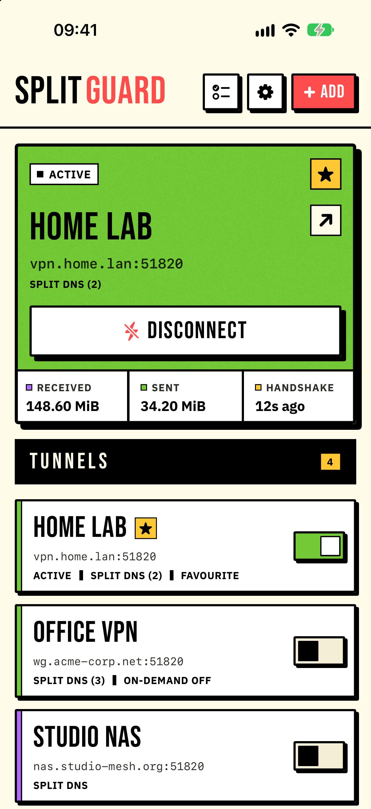

# SplitGuard

SplitGuard is a WireGuard VPN client for iPhone with per-tunnel split DNS. It runs on iOS 26 and later.

  

SplitGuard has its own WireGuard implementation, written from scratch in Swift. It does not use wireguard-go or the code from the official WireGuard app, and there is no C or Go in the app. The handshake, packet encryption, timers, and routing by Allowed IPs all run in Swift inside the app's network extension. Curve25519 and ChaCha20-Poly1305 come from Apple's CryptoKit, and the rest of the protocol, including BLAKE2s, is part of SplitGuard. The engine is tested against the reference Go implementation to make sure it talks to standard WireGuard servers.

## Split DNS

The official WireGuard iOS app sends every DNS lookup to the tunnel's DNS server while a tunnel is active. If you only connect to a home network or office VPN to reach internal services, all your regular browsing lookups still go through that server.

SplitGuard lets you choose how DNS works per tunnel. You can send all lookups to the tunnel's DNS server like the official app does, or pick a list of domains instead. Each domain you add covers itself and its subdomains, and everything else uses the normal DNS of your current Wi-Fi or cellular network. If the tunnel's endpoint uses a hostname, the editor suggests that domain.

You can also add exceptions: names inside a VPN domain that should still use normal DNS, such as a public website on your company's domain. An exception can cover only the exact name or the name and its subdomains.

A routing preview shows which domains use the VPN's DNS server and which stay on normal DNS. While connected, you can type a hostname into the built-in tester to see which DNS path it takes and what address it resolves to.

Split DNS rules are saved with the standard WireGuard configuration. When you export tunnels, those rules are written as `# SplitGuard:` comments in the `.conf` file, so other WireGuard apps ignore them and can still import the file.

## Kill switch

Tunnels that route all IPv4 traffic (`0.0.0.0/0`) can turn on a kill switch, which blocks all traffic outside the tunnel while it is connected. You can choose to allow the local network so AirPlay, AirDrop, and printers keep working. When the server stops answering or there is no network, the tunnel screen says that traffic is being blocked and why.

## Health alerts

SplitGuard can send a notification when no handshake succeeds for a set time while the app is closed, and another one when the connection recovers. You pick the delay per tunnel. This setting stays on your iPhone and is not included in exports.

## Connection status

The tunnel screen shows the connection state, data sent and received, and the time since the last handshake. If the server never answers, it tells you how many handshake attempts went unanswered and lists the usual causes: a wrong key, a wrong endpoint, or a blocked port. You can pin a primary tunnel to the top of the list.

## Everything else

- Add tunnels by scanning a QR code, opening a `.conf` file, pasting a configuration from the clipboard, or creating one from scratch with a generated keypair. SplitGuard asks for a name after an import.
- Keep multiple tunnels configured, with one active at a time.
- Edit interface, peer, DNS, and behavior settings in a tabbed editor.
- Connect automatically with on-demand rules for Wi-Fi and cellular, with optional rules to include or exclude specific Wi-Fi networks.
- Connect, disconnect, toggle, or check a tunnel from Shortcuts and Siri.
- Connect or disconnect a tunnel when a Focus starts.
- Toggle recent tunnels from the Home Screen quick actions menu.
- Export all tunnels as a `.zip` archive behind Face ID or your device passcode. Viewing private keys also requires authentication.
- View and export tunnel logs.
- Switch between light, dark, and system appearance.

## Privacy

SplitGuard has no accounts, analytics, tracking, or backend server. It only connects to the WireGuard servers you configure. Tunnel configurations stay on your iPhone, with private keys stored in the iOS Keychain. See [PRIVACY.md](PRIVACY.md) for the full privacy policy.
